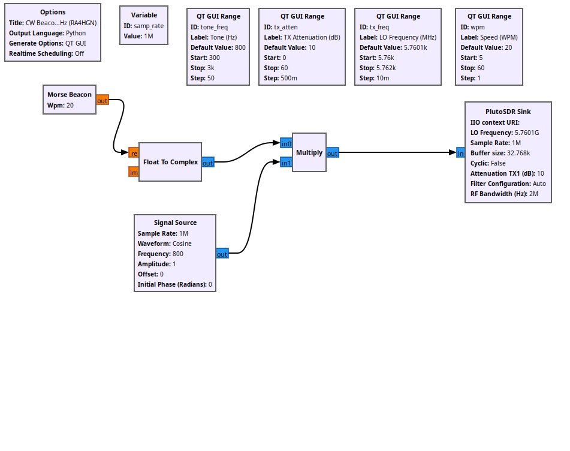
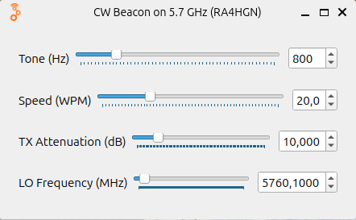

# CW Beacon on 5.7 GHz (RA4HGN)

A Morse-code (CW) beacon for the
[ADALM-PlutoSDR](https://www.analog.com/en/design-center/evaluation-hardware-and-software/evaluation-boards-kits/adalm-pluto.html).
It transmits a repeating `CQ CQ DE BEACON` message in the 6 cm amateur band
(around 5760 MHz).

The project ships **two implementations** of the same beacon:

| Version | Where it runs | Use it when |
|---|---|---|
| **GNU Radio** (`gnuradio/`) | on a host PC, streams I/Q to the Pluto | you want a GUI, live controls, easy tweaking |
| **On-target C** (`on-target/`) | directly on the Pluto's ARM CPU (autonomous) | you want a standalone beacon with no PC |

## Screenshots

| Flowgraph (GNU Radio) | GUI window |
|---|---|
|  |  |

## Version 1 — GNU Radio (`gnuradio/`)

- Complex 800 Hz tone → signal at **LO + 800 Hz**.
- Live Qt GUI: LO frequency (5760–5762 MHz, 10 kHz step), tone (300–3000 Hz),
  speed (5–60 WPM), TX attenuation (0–60 dB).
- Baseband sample rate 1 MHz, streamed to the Pluto over USB.

Requirements: GNU Radio 3.10+ with `gr-iio`, Python 3, NumPy, PyQt5.

```bash
cd gnuradio
grcc microwave_morse_beacon.grc      # optional: regenerate the .py
python3 microwave_morse_beacon.py    # or open the .grc in GNU Radio Companion
```

The transmitted text is defined in
`gnuradio/microwave_morse_beacon_epy_block_0.py` (`self.message`).

## Version 2 — On-target C (`on-target/`)

Autonomous beacon that runs on the Pluto itself, using the FPGA's built-in
DDS tone generator (no I/Q streaming). Build, upload and run instructions are
in [`on-target/README.md`](on-target/README.md).

The transmitted text is defined in `on-target/beacon.c` (`#define MSG`).

## Frequency range: AD9363 vs AD9364 (6 GHz)

The beacon transmits at **5760.100 MHz**, which is above the AD9363's official
**3.8 GHz** limit. The Pluto's silicon can actually tune up to **6 GHz**, but
the IIO driver only exposes that range when the firmware reports an
**AD9364** model.

Check what your unit exposes:

```bash
iio_info -a | grep -E 'hw_model|frequency_available'
```

- **Rev.B / Rev.D** report `... (Z7010-AD9364)` and `frequency_available` up
  to `6000000000` → the 6 GHz range is already enabled, nothing to do
  (this is the case for the unit this project was built on).
- **Rev.A / Rev.C** report `... AD9363` and top out at `3800000000` → the
  range is firmware-limited. To extend it to the AD9361/AD9364 **6 GHz**
  range, change the device-tree `model` in the Pluto firmware from `AD9363`
  to `AD9364` (Analog Devices `plutosdr-fw` / Buildroot) and reflash. The
  silicon supports it — this is the well-known "Pluto 6 GHz mod".

Either way, once `frequency_available` reaches `6000000000`, the beacon on
5760.100 MHz works.

## License

[GPL-3.0](LICENSE).

## Author

RA4HGN
